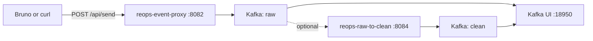

# Local testing: HTTP in, Kafka out

Test one boundary at a time. This proxy needs only Kafka; no Postgres, BigQuery,
tracking script, or rest of the pipeline is required.



**What this branch proves:** the HTTP `X-Opt-Out-Filters: name` header becomes a
Kafka record header named `x-opt-out-filters`, containing UTF-8 JSON `["name"]`.
It is not a field in the JSON body.
The proxy does not redact names. To observe names being redacted or preserved,
also run `reops-raw-to-clean` as described below.

Use only synthetic test data. These requests target localhost, not dev or prod.

## 1. Start Kafka and the proxy

Prerequisites: Docker with Compose and the JDK required by this repo's build.
Run from the repository root:

```bash
docker compose -f .compose/docker-compose.yaml up -d controller-1 broker-1 kafka-ui
docker compose -f .compose/docker-compose.yaml ps
```

Wait for the broker to become healthy. In another terminal, from the same root:

```bash
./gradlew bootRun --args='--spring.profiles.active=local --management.tracing.enabled=false'
```

Tracing is disabled for this minimal setup, so no OpenTelemetry collector is
needed. Host apps connect to `localhost:9094`; containers on this Compose network
connect to `broker-1:9092`.

## 2. Send events with Bruno

Refresh or reopen the existing **ResearchOps** collection from
`../reops-meta/tooling/researchops-bruno`. Open **reops-event-proxy → Local
opt-outs** and run these requests individually. The existing dev request is
unchanged; all requests in **Local opt-outs** target `localhost:8082`.

| Request | Expected HTTP status | Expected `raw` record header |
| --- | --- | --- |
| Baseline - no opt-out | `201` | No `x-opt-out-filters` |
| Name opt-out | `201` | `x-opt-out-filters: ["name"]` |
| Mixed opt-outs | `201` | `x-opt-out-filters: ["uuid","name"]` |

The mixed request sends `UUID, Name,unknown,uuid,NAME`: case is normalized,
unknown tokens ignored, duplicates removed. Bruno tests check the HTTP response
only; inspect Kafka separately to verify the outgoing header.

Each request includes a different `payload.data.testCase` marker. Re-running a
request publishes another record; it does not replace the previous one.

### curl alternative

```bash
curl -i http://localhost:8082/api/send \
  -H 'Content-Type: application/json' \
  -H 'User-Agent: reops-local-test' \
  -H 'X-Opt-Out-Filters: name' \
  --data '{
    "type": "event",
    "payload": {
      "website": "550e8400-e29b-41d4-a716-446655440000",
      "hostname": "localhost",
      "url": "http://localhost/local-test",
      "name": "Ola Nordmann",
      "title": "Ola Nordmann",
      "data": {
        "testCase": "name-opt-out",
        "person": "Ola Nordmann",
        "contact": "Ola.Nordmann@example.com"
      }
    }
  }'
```

The website only needs to be a valid UUID at this boundary; no website database
lookup happens here. Expect `201 Created` with session/cache metadata, not an echo
of the event. The response is returned after the Kafka send completes; it does
not mean any downstream consumer has processed the record.

## 3. Inspect the actual output in Kafka UI

1. Open http://localhost:18950 and select `kafka-cluster`.
2. Open **Topics → raw → Messages**. Refresh the topic list if necessary.
3. Load recent messages (or start from the beginning for a small local topic).
4. Expand a record. Inspect both its **value** and **headers**, decoded as text.
5. Match `payload.data.testCase` to the request you sent.

For `Name opt-out`, expect:

- Value: `payload.name`, `payload.title`, and `payload.data.person` still contain
  `Ola Nordmann`. This is also true for the baseline: the proxy does no PII redaction.
- Header: `x-opt-out-filters` contains `["name"]`.
- Other headers include `user-agent`, `x-reops-session-id`, `x-reops-visit-id`,
  and `x-reops-created-at`.
- A generated Kafka key. Save it if comparing this record with downstream output.

Kafka UI reads records without removing them. The redactor can consume the same
records independently.

### CLI alternative: no extra installation

The broker container already contains Kafka's console consumer:

```bash
docker compose -f .compose/docker-compose.yaml exec broker-1 \
  /opt/kafka/bin/kafka-console-consumer.sh \
  --bootstrap-server broker-1:9092 \
  --topic raw \
  --from-beginning \
  --property print.key=true \
  --property print.headers=true \
  --property print.partition=true \
  --property print.offset=true
```

This prints existing records, then waits for new ones. Stop with Ctrl-C.
`print.headers=true` matters: inspecting only the JSON value cannot verify this
branch. No `kcat` or separate Kafka installation is needed.

## 4. Optional: verify redaction with one more component

Use a checkout of `../reops-raw-to-clean` that supports the `name` opt-out.
Its local profile uses the same broker, consumes `raw`, and produces `clean`.
Do not start its Compose stack as well; share the Kafka instance above.

In a new terminal:

```bash
cd ../reops-raw-to-clean
./gradlew bootRun --args='--spring.profiles.active=local --management.tracing.enabled=false'
```

Once it is running, send the Bruno requests again. Inspect **Topics → clean →
Messages** in Kafka UI. Match the Kafka key to the corresponding `raw` record;
the redactor preserves it. With the current name-redaction rules, expect:

| Field | Baseline | Name opt-out |
| --- | --- | --- |
| `payload.name` | `[PROXY-NAME]` | `Ola Nordmann` |
| `payload.title` | `[PROXY-NAME]` | `Ola Nordmann` |
| `payload.data.person` | `[PROXY-NAME]` | `Ola Nordmann` |
| `payload.data.contact` | `[PROXY-EMAIL]` | `[PROXY-EMAIL]` |
| Kafka `x-opt-out-filters` header | Absent | Absent: consumed and removed |

The opt-out disables the name rule for the entire event, not just `payload.name`.
Other rules remain enabled, demonstrated by the email redaction. These expected
results also match the currently checked-out redactor's tests.

To test the redactor alone, stop the proxy and use Kafka UI's **Produce Message**
on `raw`: use the same event JSON, a non-empty string key, and a text header
`x-opt-out-filters` with value `["name"]`. Compare with another message without
that header. This bypasses HTTP and isolates Kafka → redaction → Kafka.

## Troubleshooting and stopping

- **No `raw` topic:** send a request after Kafka becomes healthy, then refresh.
  The local broker allows topic auto-creation.
- **Connection errors / non-201 response:** check broker health and proxy logs.
  Confirm the proxy started with the `local` profile, port `8082`, and broker
  `localhost:9094`.
- **Names unchanged in `raw`:** expected. Look at `clean` for redaction.
- **No `clean` records:** check the redactor checkout/profile and its logs.
  Start it before sending fresh requests; old consumer offsets can skip old data.
- **Unexpected old messages:** local Kafka data persists across restarts. Match
  the test marker, timestamps, offsets, and Kafka key rather than assuming the
  first visible record came from your latest request.
- **Header absent:** set it as an HTTP header, not a JSON property. The proxy
  accepts comma-separated tokens; it serializes the Kafka JSON array itself.

Stop JVM apps with Ctrl-C. Stop only the containers used by this guide with:

```bash
docker compose -f .compose/docker-compose.yaml stop kafka-ui broker-1 controller-1
```

No containers or persisted records are deleted.

## Automated proxy boundary test

```bash
./gradlew test --tests no.nav.reops.EndeTilEndeTest
```

This starts embedded Kafka and exercises real HTTP → Kafka, including opt-out
headers. No Docker required. It verifies proxy forwarding, not downstream
redaction.
